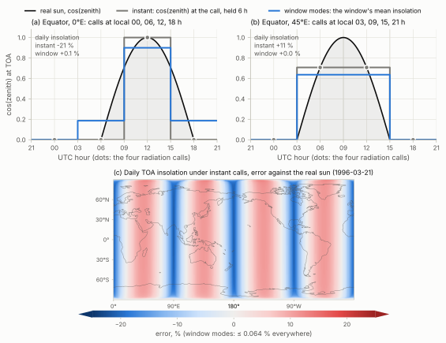
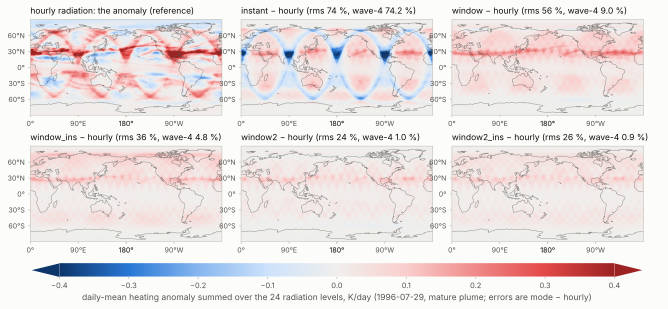
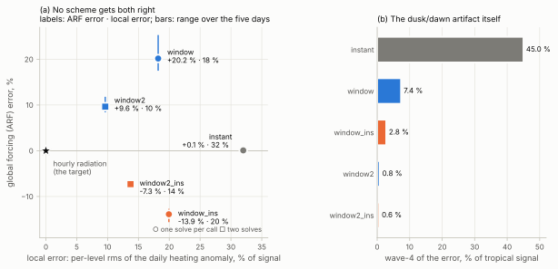
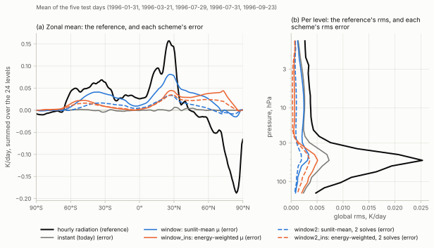
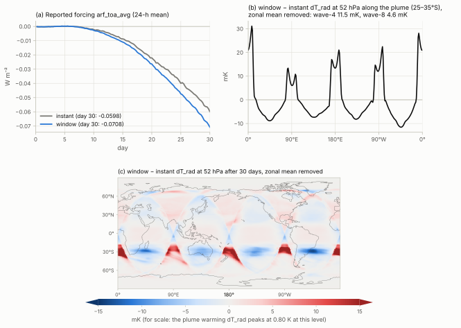
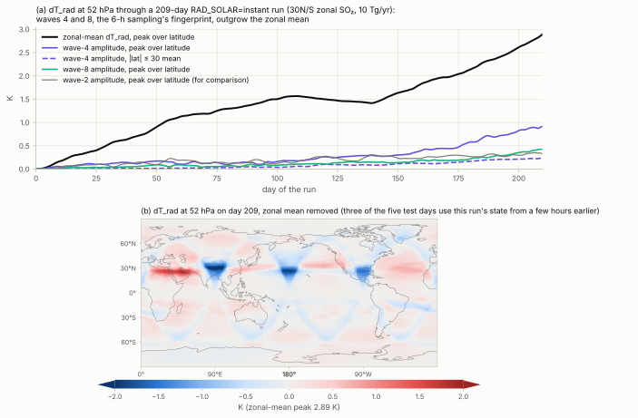
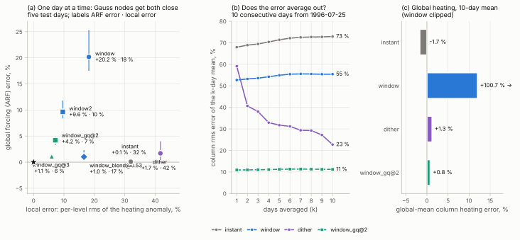

# The radiation dusk/dawn artifact: what was tried, and what it did

Written 2026-11-12, updated 2026-11-13 with the follow-ups (§3.9: the fitted
blend, the dithered sun time and the Gauss-node shortwave solves). Covers the
work of 2026-11-11/13 (and the 11-17 follow-ups), done in a development setup
whose radiation slot could also be filled by the column emulator; mentions of
the emulator below are that context, and it is not part of this repository (yet). Every number below is
MEASURED unless it is marked as a toy-model estimate, and each one names the
script and run directory that produced it. The `runs/...` directories are the
measurement runs on the development machine (gitignored, not in the repo); the
scripts are in `scripts/validation/` and `scripts/radiation/`.
[RADIATION.md](./RADIATION.md) ("Solar geometry") is the short version.

**Bottom line**
- **`window_gq` is the first scheme that gets both the global and the local
  heating right** (§3.9.2). It solves the shortwave at 2 or 3 Gauss quadrature
  points spread over the sunlit part of each 6-h window, and the longwave once.
  Against hourly radiation on the five test days, with 2 / 3 points:
  - local per-level error 7.1 % / 6.0 % (`instant` 32 %, `window2` 9.6 %)
  - global forcing (ARF) error +4.2 % / +1.1 % (`window` +20 %)
  - wave-4 of the error 3.1 % / 1.2 % (`instant` 45 %)
  - global heating error of a 10-day mean on a heavily loaded state: +0.8 %
    (2 points), where `window` is +101 % (Figure 7c)
  - cost: a radiation solve set takes 1.37× / 1.73× an `instant` one, and a
    whole model step 1.07× / 1.16× (28.2 / 30.7 s against 26.5 s on one GPU)
- `instant` (the default before 2026-11-17) gets the global forcing right (+0.1 %), but its local
  heating is wrong in fixed longitude stripes: 32 % per-level error and a wave-4
  error 45 % of the signal.
- **Every one-solve window scheme is biased.** The sunlit-mean and
  energy-weighted sun angles push the forcing in opposite directions (+20 % and
  −14 %), and both over-heat the plume. A fitted blend of the two nulls the
  forcing on held-out days (+1.0 %) but not the heating (§3.9.1).
- **Dithering the sun time** (one solve) keeps `instant`'s unbiased global mean,
  and its local error does average out over days (59 % → 23 % for a 10-day mean,
  while `instant` stays at 73 %). It stays twice as wrong as `window_gq`, and each
  6-h output is as noisy as `instant` (§3.9.3).
- **After 30 coupled days, the scheme barely matters for `dT_rad`** (§3.9.4).
  Its wave-4 along the plume is ~43 mK in all four runs (`instant`, `window`,
  `dither`, `window_gq`), and the three new schemes differ from `instant` by only
  ~6 mK. In the 209-day `instant` run, though, `dT_rad`'s wave-4/8 grows to
  0.9 K / 0.4 K peaks against a 2.9 K zonal mean (Figure 6). Whether the scheme
  causes that is still untested; a long `instant`/`window_gq` A/B would settle it.
  The one-year A/B (§3.9.5) settled it: the scheme causes it.
- **`window_gq` at 3 nodes is the default since 2026-11-17**, trailing window
  since the same day (§3.9.7), and both presets run it.

Figures: `scripts/radiation/plot_solar_artifact.py` (CPU, ~10 s) draws all seven
from the run directories named below into `docs/figures/`.

---

## 1. The problem

The model steps every 6 h (`driver_fast.py` requires `STEP_HOURS=6`). Radiation
runs once per step:
- **When:** at the step's end hour `it1`.
- **What:** RRTMGP two-stream on 55,296 columns. In `RAD_MODE=anomaly` that is
  two solves, the evolved TOMAS aerosol at T_CESM + dT_rad and the MAM4
  reference at T_CESM.
- **How the result is used:** the heating is held for the whole step,
  `dT_rad += hr_anom * STEP_SEC * RAD_EVERY` (`src/coupling.py`, radiation
  stage).
- **The sun:** `solar_zenith()` gives the instantaneous zenith at `it1`.

The calls always land on 00/06/12/18 UTC, so each longitude sees the same four
local times for the whole run. Two things follow:
- **Stationary insolation error.** The daily-mean TOA insolation each column
  receives has a stationary wave-4 error in longitude: **−24.3 to +22.8 %**
  between the equator and 60°, across six dates through the year
  (`scripts/validation/test_solar_window.py`, check 4).
- **All-or-nothing terminator columns.** A column just before dawn at `it1` gets
  no sunlight for six mostly-daylit hours. A column just after dusk gets an
  afternoon's worth.

The heating error therefore has a fixed wave-4 pattern, and `dT_rad` is a
non-advected Eulerian increment field, so it accumulates there. That is the
dusk/dawn artifact.



**Figure 1. Where the artifact comes from (geometry only).**
- **(a, b)** On the equator on 1996-03-21, two longitudes 45° apart see the four
  calls at different local times.
  - Holding the instantaneous cos(zenith) for 6 h gives 0°E only 79 % of the
    day's insolation (−21 %) and gives 45°E 111 % (+11 %).
  - The window modes deliver each window's exact mean.
- **(c)** The result is a stationary wave-4 error in each column's daily
  insolation under `instant`. The window modes are within 0.064 % everywhere.

---

## 2. What was tried

| `RAD_SOLAR` | sun angle per solve | TOA irradiance | solves per call | status |
|---|---|---|---|---|
| `instant` | instantaneous at `it1` | TSI | 1 | default before 2026-11-17, bit-identical to all earlier runs |
| `window` | **sunlit-mean** μ_eff = μ̄/f over the 6 h centred on `it1` (Hogan & Hirahara 2016) | TSI · f | 1 | implemented, tested, biased |
| `window_ins` | **energy-weighted** μ_ins = ∫μ²/∫μ (Cronin 2014) | TSI · μ̄/μ_ins | 1 | experimental |
| `window2` | the window's two 3-h halves, each at its sunlit-mean μ | TSI · f_half | 2 | experimental |
| `window2_ins` | the two halves, each at its energy-weighted μ | TSI · μ̄_half/μ_ins,half | 2 | experimental |
| `window_blend` | (1−α) μ_eff + α μ_ins, α = `RAD_SOLAR_ALPHA` (fitted 0.53) | TSI · μ̄/μ | 1 | experimental (§3.9.1) |
| `dither` | instantaneous, at `it1` + δ, δ a golden-ratio sequence in [−3, 3) h | TSI | 1 | experimental (§3.9.3) |
| `window_gq` | instantaneous, at each of N Gauss–Legendre nodes of the sunlit part of the window (`RAD_SOLAR_NODES`, default 3) | TSI · quadrature weight, renormalised so μ̄ is exact | 1 LW + N SW | **default since 2026-11-17** (§3.9.2, §3.9.5) |

Shared by all the window modes:
- **Exact insolation.** scale · cos(zenith) = μ̄, the window mean of
  max(cos zenith, 0), so each window's TOA insolation is exact.
- **Closed form.** `solar_window()` in `src/radiation/radiation.py` computes the
  geometry exactly for any width. With cos zenith = a + b cos h in hour angle h,
  the sunlit arc is |h| < arccos(−a/b), and the integrals of max(μ, 0), max(μ, 0)²
  and the sunlit indicator have periodic antiderivatives. The declination is
  held at the window centre, which moves it by less than 0.1° over 6 h.
- **Surface albedo** is the window's insolation-weighted albedo,
  1 − ΣFSNS/ΣFSDS over the hourly records inside the window. Archive record k is
  the mean over [k−1 h, k] (`time_bnds`, checked with ncdump), so the 6-h window
  uses records `it1−2 … it1+3`. The two-solve modes use each half's own records.
  Without this, columns dark at `it1` but sunlit later in the window would get
  the 0.15 fallback albedo, which is about 4 % of the insolation.
- **Per-column irradiance** goes to jax-rrtmgp as an (nx, ny) array. No new
  patch is needed: `rrtmgp/rte/two_stream.py:406` builds
  `toa_flux = irrad * solar_fraction * ones(nx, ny)`, which broadcasts it.
- **Night columns** get zenith = π, which RRTMGP treats as night (zenith ≥ π/2).
- **Reference cache.** The key gains `{'solar': {mode, window_h}}` only when the
  mode is not `instant`. Existing caches keep hitting, and each mode and width
  gets its own directory.
- **Pinned to instantaneous geometry:** the two harnesses that assert zero SW where the instantaneous sun is down
  (`test_rad_cache.py`, `test_radiation.py`).
- **Bookkeeping.** `PHYS_CFG` stores the mode index (0 instant … 4 window2_ins,
  5 window_blend, 6 dither, 7 window_gq; appended, warn-only on resume), plus
  `RAD_SOLAR_ALPHA` and `RAD_SOLAR_NODES` for the modes that use them. The run header echoes the mode and window.
  The launcher flag is `run_prod.py --rad-solar`.

**Considered and not pursued:**
- **Rescaling the solved heating by μ̄/μ(it1).** This fails exactly where the
  artifact lives: at the terminator μ(it1) = 0, so there is nothing to rescale.
- **Hourly steps (`STEP_HOURS=1 RAD_EVERY=6`).** `driver_fast.py` refuses any
  step other than 6 h.
- **An online hourly-radiation reference** (six solves per 6-h step, using the
  hourly meteorology). This needs a new code path at 6× the radiation cost. The
  user chose to run only instant against window online (§3.6).
- **A 10-minute sun-step geometry reference over all test days.** The user asked
  to defer this; §3.4 is a one-day, 30-minute version of it.

---

## 3. How it was tested, and the results

### 3.1 Geometry, on CPU (`scripts/validation/test_solar_window.py`, ~15 s, passes)

- **Closed form against a 4000-point midpoint rule:**
  - μ̄ to 1.3e-7, f to 4.8e-4. The f error is the midpoint rule's own floor at
    the terminator.
  - Covers widths of 1, 6, 12 and 30 h, six dates, and three hours, including
    the exact ±90° rows and the hour-angle wrap.
- **Energy-weighted μ_ins:** matches brute force to 4.3e-5, and
  scale · cos(zenith) = μ̄ to 3e-16.
- **Halves:** the two half-windows carry the full window's insolation to 7e-4.
  The difference is that each half uses its own centre's declination, which is
  the more accurate of the two.
- **Zero-width limit:** recovers `solar_zenith()` to 9e-9.
- **Polar cases:** polar night gives f = 0 and zenith = π; polar day gives f = 1.
- **Daily tiling:** the four 6-h windows deliver the day's insolation to within
  **≤ 0.064 %** of a 1-minute integral of the real sun. Instantaneous sampling is
  off by −24.3 to +22.8 %.

### 3.2 Bit-identity of `instant`, on GPU (`runs/rad_solar_check/`)

- **Against the committed code:** `heating()` with and without `split`, with
  aerosol and with zero aerosol, at four hours: **66/66 arrays identical**.
  The committed `src/` was extracted with `git archive`
  (`head.npz` vs `new_instant.npz`).
- **After the 2×2 refactor:** the hourly, instant and window results of the
  five-day test are **30/30 arrays identical** to the run made before the
  refactor (`runs/solar_window_check` vs `runs/solar_window_variants`).

### 3.3 TOA insolation in real RRTMGP (`runs/rad_solar_check/`, 1996-01-31)

The four-call daily mean of `sw_dn_toa` against a 1-minute daily integral, for
|lat| ≤ 60:

| | error range across columns |
|---|---|
| `window` | **±0.05 %** |
| `instant` | −21.4 to +16.2 % |

### 3.4 Geometry-only reference (`runs/rad_solar_check/rad_solar_reference.py`, 1996-01-31)

- **Reference:** each 6-h window is the mean of 12 RRTMGP solves at 30-minute
  sun positions, each with its own hour's albedo. The meteorology is held at the
  call hour, so only the geometry differs.
- **Quantity:** the evolved bins minus zero aerosol, for the 30N/S plume at
  day 30.

| | aerosol TOA SW-up (global) | vs reference | rms error of band-summed heating | zonal wave-4 of the field |
|---|---|---|---|---|
| reference | 0.3807 W m⁻² | — | — | 8.3 % (the plume's own structure) |
| `instant` | 0.3812 | +0.1 % | 17.6 % | 27.1 % |
| `window` | 0.4303 | **+13.0 %** | 10.4 % | 9.5 % |
| `window`, snapshot albedo | 0.4278 | +12.4 % | 10.1 % | 9.5 % |

**Where window's excess sits**, as the window/reference ratio of aerosol SW-up
by sunlit fraction f (in brackets, the share of insolation):

| f | ratio |
|---|---|
| ≤ 0.25 (0.6 %) | 1.11 |
| 0.25–0.5 (3.9 %) | 1.13 |
| 0.5–0.75 (10 %) | 1.17 |
| 0.75–1 (18 %) | 1.21 |
| = 1, fully lit (67 %) | **1.07** |

By latitude the excess is largest in the tropics (+15–18 %). So it is not a
terminator effect: even windows that never see sunset over-reflect. The albedo
change accounts for 0.6 points of it.

### 3.5 Against hourly radiation (`scripts/validation/check_solar_window.py`)

This is the main test (`runs/solar_window_check`, then `runs/solar_window_variants`).

**Setup:**
- **Quantity:** the daily-mean heating anomaly that drives `dT_rad`, computed
  exactly as the coupler forms it: evolved bins at T + dT_rad, minus the MAM4
  reference binned at each hour.
- **Reference:** 24 instant solves per day, each held 1 h, with the meteorology
  changing hourly.
- **Each 6-hourly mode:** 4 calls, each held 6 h.
- **Days:** 1996-01-31 (30N/S plume, day 30), 03-21 and 09-23 (a mature 1-year
  plume transplanted onto the equinoxes), 07-29 (the mature plume on its own
  date) and 07-31 (15N plume).
- **Run time:** 31 minutes on one H200.

**Mean of the five days, errors against hourly radiation:**

| mode | solves | band-summed rms | worst column | per-level rms | zonal-mean bias | wave-4 of the error | **global ARF error** (range over days) |
|---|---|---|---|---|---|---|---|
| `instant` | 1 | 44.0 % | 46.3 % | 32.0 % | **2.6 %** | 45.0 % | **+0.1 %** (−0.4 … +0.7) |
| `window` | 1 | 30.4 % | 24.8 % | 18.2 % | 29.3 % | 7.4 % | +20.2 % (+17.5 … +25.3) |
| `window_ins` | 1 | 17.4 % | 12.9 % | 19.9 % | 16.1 % | 2.8 % | −13.9 % (−15.6 … −12.7) |
| `window2` | 2 | **13.0 %** | 11.8 % | **9.6 %** | 12.4 % | 0.8 % | +9.6 % (+8.4 … +11.8) |
| `window2_ins` | 2 | 13.2 % | **10.4 %** | 13.7 % | 11.9 % | **0.6 %** | −7.3 % (−8.2 … −6.6) |

**How to read the columns:**
- **rms and max** are normalised by the hourly reference's rms and max.
- **Zonal-mean bias** is the largest |zonal-mean error| divided by the largest
  |zonal-mean reference|.
- **Wave-4 of the error** is the absolute zonal wave-4 amplitude of the
  band-summed error over |lat| ≤ 30, divided by the reference's tropical rms.
  This is the dusk/dawn artifact itself.
- **ARF** is coupling.py's `arf_toa`: (SW-up + OLR)_reference minus
  (SW-up + OLR)_evolved, area-weighted.

Per-day and per-latitude-band numbers are in each directory's
`check_solar_window.log`. The first run's log has a "wave-4" column normalised
by the anomaly's near-zero zonal mean, which makes it meaningless; the script
has since been fixed and the table above uses the corrected measure. Every day
shows the same signs and ordering.

**What it shows:**
1. **`instant` is right on average but wrong in place.** Its local errors are
   the largest (44 % rms, 45 % wave-4 error for mature plumes), but they cancel
   in the zonal and global mean almost exactly. That is expected: at any instant
   the globe as a whole samples the true distribution of sun angles, so a global
   mean taken from one snapshot is unbiased, even though each column's history
   is wrong.
2. **Every window mode removes the artifact.** The wave-4 error drops from 45 %
   to 7.4 % (window) and to 0.6–0.8 % with two solves. The local errors fall by
   2–3×.
3. **The two μ choices bias the forcing in opposite directions.** The sunlit-mean
   μ makes the solve act like a too-low sun and over-reflects (+20 %). The
   energy-weighted μ makes it a too-high sun and under-reflects (−14 %).
4. **Two solves halve the bias for either choice** (+20 → +9.6 %,
   −14 → −7.3 %) and give the best local accuracy. The cost is twice the
   radiation stage.
5. **The heating bias does not change sign between the two μ choices.** Every
   window mode heats more than hourly radiation does (Figure 4a), even
   `window_ins`, which under-reflects.
   - **Sign:** the error in the global mean of the band-summed heating anomaly
     is positive on all five days for every window mode.
   - **Size, mean of the days:** +68 % (`window`), +38 % (`window_ins`),
     +26 % (`window2`) and +29 % (`window2_ins`), against +0.5 % for
     `instant`.
   - **Why the sizes are inflated:** the reference's global mean is a partial
     cancellation of heating and cooling, so these ratios overstate the error.
     The zonal-mean-bias column (12–29 %) is the fairer measure of size.
   - **Why it differs from the forcing:** reflection (ARF) and absorption
     (heating) respond differently to the choice of μ.



**Figure 2. Daily-mean heating anomaly on 1996-07-29 (mature plume).** The
hourly reference is top left, then each scheme's error, all on one colour
scale.
- **`instant`:** the error is the four terminator ellipses of
  00/06/12/18 UTC.
- **One solve:** a smooth positive bias (`window`) or a smaller one
  (`window_ins`).
- **Two solves:** a little bias remains.
- **The reference itself shows faint ellipses.**
  - This state's `dT_rad` already carries 209 days of `instant`'s stationary
    pattern (Figure 6).
  - The reference heating's zonal anomalies are anti-correlated with it:
    r = −0.32, −0.48 and −0.35 on the three days that use this state. So the
    ellipses are partly the LW response to that pattern.



**Figure 3. The trade-off, mean of the five days.**
- **(a)** Each scheme's per-level rms error (x) against its global ARF error
  (y). The bars span the five days.
  - `instant` sits on the zero line, far to the right.
  - The window modes move left but off the line: sunlit-mean above,
    energy-weighted below. Two solves halve the offset.
- **(b)** The wave-4 of the error, which is the artifact itself.



**Figure 4. Where the errors sit, mean of the five days.**
- **(a)** The reference's zonal mean (black) and each scheme's zonal-mean error.
  - `instant`'s error (grey) is near zero at every latitude.
  - Every window mode's error is positive, largest over the 15–30°N plumes.
- **(b)** Per level, the reference's global rms and each scheme's rms error.
  The errors follow the plume's 30–70 hPa heating peak.

**Toy model against RRTMGP.** The review's one-layer delta-Eddington toy model
estimated +2–5 % global bias for `window` and ≤ 0.3 % in noon-centred windows.
RRTMGP gives +20 % and +7 %. Use toy estimates only for direction.

### 3.6 Coupled 30-day runs (`runs/solar30d_instant`, `runs/solar30d_window`)

**Setup:**
- The `bench_phys30d` scenario: 30N/S mirrored zonal SO₂ at 10 Tg/yr, injected
  at 55 hPa.
- Physics radiation (`RAD_ENGINE=rrtmgp`), with everything else at current
  defaults.
- The two runs differ only in `--rad-solar`.

Results at day 30:

| | `instant` | `window` |
|---|---|---|
| wall time | 48 min | 58 min (the window cache directory was empty, so references were computed) |
| `dT_rad` peak | +0.799 K | +0.805 K |
| zonal-mean `dT_rad`, peak / plume-integrated | — | +1 % / +3.5 % |
| `dT_rad` zonal wave-4 at 52 hPa | 15.0 mK | 14.7 mK |
| **window − instant, wave-4 / wave-8 at 50–75 hPa** | | **2.4–3.0 mK / 1.0–1.6 mK** |
| reported `arf_toa_avg` (24-h), day 30 | −0.0598 W m⁻² | −0.0708 (**+18 %**) |
| `arf_toa_avg`, mean of days 10–30 | −0.0251 | −0.0303 (+21 %) |
| aerosol mass burden | — | ratio 0.999997 |
| window − instant at 52 / 62 hPa, wave-4 along the plume (peak latitude, ~30°S) | | **13.4 / 22.1 mK** |
| window − instant at 52 / 62 hPa, largest zonal anomaly | | 44 / 63 mK |

- **The scheme leaves a clear imprint on `dT_rad`, and it is concentrated on
  the plume.**
  - **Signature:** wave-4 plus wave-8, the 6-h sampling's fingerprint, with
    edges that follow the terminator ellipses (Figure 5c).
  - **Averaged over |lat| ≤ 30** it is about 3 mK, which is the figure the
    table above quotes.
  - **Along the sunlit (austral-summer) plume** it is 11–22 mK of wave-4 at
    52–62 hPa, against an `instant` warming peak of 0.80 K at 52 hPa, so
    about 2 %.
  - **Most of the wave-4 is not caused by the scheme:** after 30 days both
    runs' `dT_rad` have nearly the same wave-4 amplitude (111 and 121 mK,
    peak over latitude). The plume's structure dominates it.
  - **It is stationary,** so it grows with run length, damped only by the
    Planck response (§3.7).
- **The forcing diagnostic shifts much more.** It changes by 18–21 %, matching
  §3.5.
- **Not run online:** `window2` and the other variants.



**Figure 5. The coupled 30-day A/B.**
- **(a)** The reported 24-h forcing. `window`'s is 18–21 % stronger throughout.
- **(b)** The two runs' `dT_rad` difference at 52 hPa along 25–35°S, with the
  zonal mean removed.
- **(c)** The same difference as a map. The pattern is the terminator ellipses
  of the four call hours, strongest on the sunlit plume.

### 3.7 `dT_rad` through a 209-day `instant` run (`runs/lr1yr_d177_sample`)

The 1-year run `lr1yr` provides the state for three of the five test days.
- **Scenario:** the same as §3.6 (30N/S zonal SO₂ at 10 Tg/yr, 55 hPa, from
  1996-01-01).
- **Radiation:** solved with instantaneous geometry, as before the flag
  existed.

Its daily `dT_rad` frames at 52 hPa show the following:

| day | zonal-mean peak | wave-4, peak over latitude | wave-4, \|lat\| ≤ 30 mean | wave-8 peak | wave-2 peak | largest zonal anomaly |
|---|---|---|---|---|---|---|
| 30 | 0.53 K | 0.11 K | 0.012 K | 0.04 K | 0.08 K | 0.37 K |
| 100 | 1.50 | 0.16 | 0.036 | 0.08 | 0.12 | 0.52 |
| 150 | 1.64 | 0.30 | 0.117 | 0.14 | 0.23 | 1.03 |
| 209 | 2.86 | **0.90** | **0.233** | **0.43** | 0.34 | **2.33** |

At day 30 these numbers match the separate 30-day `instant` run of §3.6
(0.53 K and 0.11 K), so the two runs agree.



**Figure 6. `dT_rad` at 52 hPa through the 209-day `instant` run.**
- **(a)** Waves 4 and 8 grow faster than the zonal-mean warming after about
  day 100. The tropical-mean wave-4 grows 20× between days 30 and 209, while
  the zonal mean grows 5×. The wave-2 trace is shown for comparison.
- **(b)** The day-209 field with its zonal mean removed. Along the sunlit 30°N
  plume it has ±2 K patches whose straight, south-pointing edges follow
  terminator lines at fixed longitudes, about 90° apart.

**What this does and does not show:**
- **The pattern looks like the 6-h fingerprint:**
  - wave-4 and wave-8 dominate, and outgrow wave-2;
  - the edges are shaped like terminators and sit at fixed longitudes, over
    ocean and land alike.
- **It is not yet attributed.** At day 30 only about 10 % of `dT_rad`'s wave-4
  differed between the instant and window runs (§3.6). How much of the day-209
  pattern the scheme causes can only be measured by running `window` (or
  `window2`) alongside `instant` for 6+ months.
- **If it is the artifact, it is not small.** It would be about 30 % of the
  zonal-mean warming at the peak latitude after 7 months. That would decide the
  default for any run longer than a few months.

### 3.8 Independent code review

A 10-agent review workflow covered three areas:
- geometry and albedo math
- jax-rrtmgp, jit, cache and emulator integration
- coupling, config and docs

It raised 7 findings, and a separate skeptic tried to refute each one. 6 were
confirmed, and all 6 are fixed:
1. **`RAD_SOLAR=window` crashed under `BC_SRC=clim`.** The climatology archive
   serves one hour per read, and the window albedo read a slice. It now reads
   hour by hour; on the CESM archive this is bit-identical (CPU-checked at 3
   hours).
2. **A misquoted range.** The instant insolation error was quoted as −21..+23 %
   in five docs; the cited test prints −24.3..+22.8 %.
3. **Two harnesses followed `RAD_SOLAR` from the environment** while asserting
   zero SW where the instantaneous sun is down. They are now pinned to
   `instant`.
4. **`check_solar_window.py` wrapped silently** to the end of the archive for a
   1996-01-01 day. It now has a range guard.

The refuted finding was that no `PHYS_CFG` warning appears when a pre-flag
checkpoint is resumed under `window`. That is the documented append-only prefix
rule, not a defect.

### 3.9 Follow-ups (2026-11-12/13)

Three follow-ups, all scored with the same harness and hourly reference as §3.5.

#### 3.9.1 A fitted blend of the two sun angles (`window_blend`, `runs/solar_blend/`)

- **Method:** one solve at μ = (1−α) μ_eff + α μ_ins, TOA irradiance
  TSI · μ̄/μ, so the insolation stays exact.
- **Fit:** α was fitted on 6 days independent of the test days in both date and
  aerosol state (02-20, 04-25, 06-21, 08-30, 11-05, 12-21). The mean-of-days ARF
  error crosses zero at **α = 0.53**. The per-day crossings run from 0.39 to
  0.70, which is about ±4 % of ARF on a single day.
- **Held out** (the five test days of §3.5): ARF error **+1.0 %**
  (+0.3..+2.3 %), per-level rms 16.6 %, wave-4 2.3 %.
- **Heating is not fixed.** On the fit days the global-mean heating error falls
  monotonically with α, from +32 % at α = 0 to +17 % at α = 1. It has no zero in
  [0, 1]. So the blend fixes the forcing number only.

#### 3.9.2 Gauss-node shortwave solves (`window_gq`)

- **Method** (`solar_gauss()` in `src/radiation/radiation.py`):
  - For each column, find the sunlit part of the 6-h window (closed form, as in
    `solar_window()`).
  - Place N Gauss–Legendre nodes across it, and solve the shortwave at the
    instantaneous sun of each node with irradiance TSI × quadrature weight.
  - Renormalise the weights so the window's insolation is exact.
  - Solve the longwave once: it does not see the sun.
- **Why this works where `window2` does not:** `window2` evaluates each 3-h half
  at one averaged μ, so the nonlinearity bias stays inside each half. Gauss nodes
  sample the real sun at well-placed instants, and the quadrature integrates the
  smooth daytime response with error falling fast in N. Restricting the nodes to
  the sunlit part keeps the kink at sunrise/sunset out of the integrand.
- **CPU gate** (`test_solar_window.py` check 5), worst column error of a
  nonlinear test response against brute force: `window` 61 %, 2 nodes 13 %,
  3 nodes 1.9 %, 4 nodes 0.6 %. Insolation exact to 1e-14.
- **Against hourly radiation** (5 test days, `runs/solar_followup/check_gq_dither.log`):

  | mode | solves per call | col rms | per-level rms | zm bias | wave-4 | ARF error (range) |
  |---|---|---|---|---|---|---|
  | `instant` | 1 | 44.0 % | 32.0 % | 2.6 % | 45.0 % | +0.1 % (−0.4..+0.7) |
  | `window` | 1 | 30.4 % | 18.2 % | 29.3 % | 7.4 % | +20.2 % (+17.5..+25.3) |
  | `window2` | 2 | 13.0 % | 9.6 % | 12.4 % | 0.8 % | +9.6 % (+8.4..+11.8) |
  | `window_blend@0.53` | 1 | 23.0 % | 16.6 % | 22.3 % | 2.3 % | +1.0 % (+0.3..+2.3) |
  | **`window_gq@2`** | 1 LW + 2 SW | **6.1 %** | **7.1 %** | 3.2 % | 3.1 % | **+4.2 %** (+3.3..+4.9) |
  | **`window_gq@3`** | 1 LW + 3 SW | **5.0 %** | **6.0 %** | 1.9 % | 1.2 % | **+1.1 %** (+1.0..+1.3) |

  The lightly loaded states are the easiest (1.9–2.5 % per-level rms); the
  heavily loaded ones are harder (6–15 %, worst on 1996-07-29).
- **Global heating** (10-day mean on the heavily loaded state, §3.9.3): +0.8 %
  with 2 nodes. `window` is +101 % and `instant` −1.7 %.
- **One longwave solve.** `_hr_multi_impl()` writes out RRTMGP's clear-sky
  `compute_heating_rate` so the longwave is solved once and the shortwave N
  times. `scripts/validation/check_solar_gq_sw.py` checks it against N full
  solves on the GPU: equal to 5e-16 in heating and in every diagnostic, for
  N = 2 and 3. That check also catches a jax-rrtmgp change that breaks the copy.
- **Cost** (`runs/solar_followup/check_gq_sw.log` and `runs/solar_bench_*`,
  GPU 0 alone):

  | mode | one radiation solve set | ×instant |
  |---|---|---|
  | `instant` / `window` | 2.70 s | 1.00 |
  | `window_gq@2`, N full solves | 5.41 s | 2.00 |
  | `window_gq@2`, 1 LW + 2 SW | 3.69 s | 1.37 |
  | `window_gq@3`, N full solves | 8.09 s | 3.00 |
  | `window_gq@3`, 1 LW + 3 SW | 4.68 s | 1.73 |

  Whole model steps (2-day runs, GPU 0 alone, no reference cache so every mode
  also solves the reference call; mean of steps 1–7, `runs/solar_bench_*`):

  | mode | radiation per step | everything else | step | ×instant |
  |---|---|---|---|---|
  | `instant` | 8.6 s | 17.9 s | 26.5 s | 1.00 |
  | `window_gq@2` | 10.5 s | 17.8 s | 28.2 s | 1.07 |
  | `window_gq@3` | 12.6 s | 18.1 s | 30.7 s | 1.16 |

  So a simulated month costs about 53 / 56 / 61 min. Radiation is a third of a
  step, so even 3 nodes adds only 16 %.

#### 3.9.3 Dithered sun time (`dither`) and the multi-day test

- **Method:** `instant`, but the sun is taken at `it1` + δ. δ follows a
  golden-ratio (Weyl) sequence in [−3, 3) h indexed by the absolute call number,
  so it depends only on the date (restarts and the reference cache see the same
  offsets). Plain TSI; the surface albedo is that of the hour around the
  sampled time.
- **The idea:** `instant` is unbiased globally because each call samples every
  local time across longitudes, and wrong locally because every place sees the
  same four local times every day. Dithering keeps the first property and
  breaks the second. Over many calls each place samples its whole day, so its
  error should average out in `dT_rad` instead of building a fixed pattern.
- **One day at a time** it is as wrong as `instant` (per-level rms 41.7 %,
  ARF +1.7 %), as expected. That is not the test.
- **The test** (`scripts/validation/check_solar_accum.py`, `runs/solar_followup/check_accum.log`):
  10 consecutive days from 1996-07-25 on one frozen, heavily loaded state, each
  day with its own meteorology. Each scheme's k-day mean is scored against the
  k-day mean of hourly radiation. There is no damping, so this is the worst case
  for errors that pile up.

  | mode | col rms, k = 1 → 10 | wave-4, k = 1 → 10 | global heating error (k = 10) | ARF error (k = 10) |
  |---|---|---|---|---|
  | `instant` | 68 → 73 % | 68 → 74 % | −1.7 % | −0.3 % |
  | `window` | 53 → 55 % | 8 → 9 % | +100.7 % | +17.5 % |
  | `dither` | 59 → **23 %** | 18 → **1.8 %** | +1.3 % | +0.5 % |
  | `window_gq@2` | 11 → 11 % | 3.3 → 3.5 % | +0.8 % | +3.7 % |

  `dither`'s error does average out, and its global mean stays unbiased. It
  stays twice as wrong as `window_gq` after 10 days, though, and every single 6-h
  heating field and ARF sample carries `instant`-sized noise.



**Figure 7. The follow-ups.**
- **(a)** Local error against forcing error, mean of the five test days (bars:
  range over the days). `window_gq` sits closest to the target, next to the
  origin, and is the only scheme near it on both axes.
- **(b)** Column rms error of the k-day mean heating against k, 10 consecutive
  days. `instant` and `window` are flat (their error sits in the same place
  every day); `dither` falls; `window_gq` is low from day 1.
- **(c)** Global-mean column heating error of the 10-day mean. `window` (+101 %,
  clipped) over-heats this heavily loaded state; the others are within 2 %.

#### 3.9.4 Coupled 30-day runs (`runs/solar30d_{dither,window_gq2}`)

Same scenario and flags as §3.6, alongside the `instant` and `window` runs.

| run | ARF vs `instant`, days 20–30 | `dT_rad` zonal-mean peak, 52 hPa | wave-4 along the plume, 52 hPa | wave-4 of the difference from `instant` |
|---|---|---|---|---|
| `instant` | — | 526 mK | 42.7 mK | — |
| `window` | +19.9 % (+17.6..+22.8) | 531 mK | 43.3 mK | 6.7 mK |
| `dither` | +0.4 % (−8.9..+11.2) | 528 mK | 43.1 mK | 6.4 mK |
| `window_gq@2` | +3.5 % (+0.7..+5.9) | 527 mK | 42.9 mK | 6.2 mK |

(Plume = 25–35° in both hemispheres. The difference column is the wave-4 of
`run − instant`.)
- **Forcing:** matches the offline tests. `window` reports ~20 % more forcing;
  `window_gq` ~3.5 % more; `dither` agrees on average but swings ±10 % from one
  output to the next.
- **`dT_rad`:** its wave-4 along the plume is the same, ~43 mK, in all four runs.
  So after 30 days that pattern comes from the plume and the meteorology, not
  from the radiation timing. Each new scheme differs from `instant` by ~6 mK of
  wave-4, about 1 % of the zonal-mean warming.
- **Open:** whether the scheme's imprint grows over months (§3.7). Answered by
  the one-year A/B (§3.9.5): it does.

#### 3.9.5 One-year coupled A/B (`runs/solar1yr_{instant,window_gq3}`)

Same scenario as §3.6 (30N/S zonal SO₂ at 10 Tg/yr), 8760 h from 1996-01-01,
`instant` against `window_gq@3`, each on its own GPU so the runtimes are clean
(`runs/solar1yr/run.sh`).

| | day 30 | day 180 | day 365 |
|---|---|---|---|
| wave-4 of `dT_rad` along the plume, 52 hPa, `instant` | 43 mK | 270 mK | **484 mK** (902 mK at worst) |
| same, `window_gq@3` | 43 mK | 89 mK | **101 mK** (207 mK at worst) |

- **The stripes are the scheme.** They separate only after ~2 months, which is
  why the 30-day runs (§3.9.4) showed no difference. Under `instant` they keep
  growing all year; under `window_gq` they level off near 100 mK.
- **Everything averaged agrees.** Zonal-mean warming within 0.7 %, global ARF
  within 0.2–1.2 % (`window_gq` stronger), sulfate burden identical.
- **Cost.** With the reference cached, radiation per 6-h step goes from 3.4 s to
  5.1 s (+52 %), about +10 % for the year (12.3 h → ~13.5 h, estimated from the
  cache-hit steps). A first `window_gq` run over a period also builds its own
  reference cache, about 3 h per simulated year, once.

**Against hourly radiation on the mature plume** (`runs/solar1yr_hourly/`,
`check_solar_accum.py`): each run's day-365 aerosol and `dT_rad`, frozen, scored
on 1–9 January 1997. Errors of the 9-day mean against the 9-day mean of hourly
radiation:

| starting state | scheme | column rms | per-level rms | wave-4 | global ARF |
|---|---|---|---|---|---|
| `instant` day 365 | `instant` | 69 % | 64 % | 88 % | +0.8 % |
| | `window` | 59 % | 37 % | 13 % | +19.5 % |
| | `window_gq@3` | **9 %** | **9 %** | **2.7 %** | +1.2 % |
| `window_gq@3` day 365 | `instant` | 88 % | 80 % | 133 % | +0.8 % |
| | `window` | 76 % | 46 % | 19 % | +19.5 % |
| | `window_gq@3` | **12 %** | **11 %** | **4.1 %** | +1.2 % |

- `window_gq` stays as close to hourly radiation on the year-old plume as on the
  test days. `instant`'s local error is much larger than on the test days (32 %),
  because the mature plume is zonally structured.
- **The errors do not average out.** The 9-day means are within a point or two
  of day 1 for every scheme: the errors are systematic. (The 10-day run was
  stopped after day 9 for that reason.)
- `window_gq`'s +1.2 % global ARF error is ~0.035 W m⁻² of ~−3 W m⁻². Its LW is
  bit-identical to `instant`'s at the same call hours, so its excess over
  `instant` is shortwave. §3.9.6 splits the rest.

#### 3.9.6 Where `window_gq`'s remaining error comes from (`runs/solar_gq_lw/`)

`scripts/validation/check_solar_gq_lw.py`: the same hourly check, 3 days
(1–3 January 1997) from each day-365 state, every solve with `split=True`, so
each error splits into its SW and LW heating and its SW (TOA SW-up) and LW (OLR)
part of the forcing. All percentages are of the hourly TOTAL, so the parts add.
Two values per cell: from the `instant` / `window_gq@3` day-365 state.

| variant | column rms | wave-4 | global ARF | ARF error, W m⁻² |
|---|---|---|---|---|
| `window_gq@2` | 11.5 / 14.7 % | 5.3 / 7.8 % | +4.4 % | 0.132 |
| `window_gq@3` (default) | 9.3 / 12.0 % | 2.7 / 4.0 % | +1.2 % | 0.036 |
| `window_gq@4` | 8.1 / 10.5 % | 1.5 / 2.2 % | +0.7 % | 0.021 |
| `@3` + window-mean Ts (σTs⁴ = mean FLNS+FLDS over the window) | 9.3 / 12.0 % | 2.7 / 4.1 % | +1.2 % | 0.036 |
| `@3` + 2 LW solves (t−1, t+2, own meteorology) | 9.3 / 11.9 % | 2.6 / 3.9 % | +1.2 % | 0.036 |
| `@3` + exact hourly LW (upper bound) | 9.3 / 11.9 % | 2.6 / 3.9 % | +1.2 % | 0.036 |

- **The LW is not the problem.** Its part of the ARF error is 0.0001 W m⁻² of
  0.036, and ~1 % of the column error. Window-mean Ts or more LW solves change
  nothing.
- **The rest is all SW, and more nodes reduce it**: 4 nodes give +0.7 % ARF and
  halve the wave-4, for one more SW solve per call.
- **It levels off.** The steps shrink fast (+4.4 → +1.2 → +0.7 %), so the
  extrapolated floor is ~+0.6 % ARF and ~7 % column error: what the SW still
  holds at the call hour (meteorology, reference aerosol, albedo), or partly the
  hourly reference's own once-an-hour sun sampling.
- **Kept at 3 nodes.** +1.2 % (0.036 W m⁻²) is well below the clear-sky,
  AOD-calibration and emulator uncertainties in the absolute forcing; 4 nodes
  stays an option (`RAD_SOLAR_NODES=4`).

#### 3.9.7 Centred or trailing window (`runs/solar_align/`)

Radiation runs at hour t, the **last** hour of each 6-h step, on that step's end
state, and its heating is added to `dT_rad` at t for the next step. Everything
above centred `window_gq`'s window on t (t−3..t+3 h), so 3 h of each call's
sunlight lies in the next step. The alternative is the window that ends at t
(t−6..t, the step just finished), which keeps `dT_rad` causal but moves the
inputs held at t (meteorology, aerosol, reference aerosol) from the window's
centre to its end. `scripts/validation/check_solar_align.py`: 3 days (1–3 January
1997) from each day-365 state, each alignment scored against the hourly
reference over the hours its windows cover (centred c−2..c+21, trailing
c−5..c+18). Two values per cell: `instant` / `window_gq@3` day-365 state.

| window | column rms | per-level rms | wave-4 | global ARF |
|---|---|---|---|---|
| centred, t−3..t+3 | 9.3 / 12.0 % | 9.2 / 11.5 % | 2.7 / 4.0 % | +1.19 % |
| trailing, t−6..t | 9.3 / 12.0 % | 9.5 / 12.1 % | 2.2 / 3.4 % | +1.14 % |
| (trailing reference vs centred reference) | 2.3 / 2.9 % | 3.7 / 4.6 % | 0.4 / 0.6 % | −0.00 % |

- **No real difference.** Column error is equal; the per-level error is 0.3–0.6
  pt worse (the inputs up to 6 h from a node instead of 3), the wave-4 0.5 pt and
  the ARF 0.05 pt better. Day 1 alone showed a 0.5 pt column gap that averaged out.
- **The 3-h shift itself barely moves the truth**: the two hourly references
  differ by 2–3 % in column heating and not at all in global ARF.
- **Default `trailing` since 2026-11-17** (`RAD_SOLAR_ALIGN`), for causality at
  no measurable cost. The one-year A/B (§3.9.5) and §3.9.6 ran `centred`
  (`RAD_SOLAR_ALIGN=centred` reproduces them).

---

## 4. Conclusions

- **`window_gq` is the scheme to adopt** (§3.9.2); the one-year A/B confirms
  it (§3.9.5).
  With 2–3 Gauss-node shortwave solves per call it is within 6–7 % locally and
  1–4 % globally of hourly radiation, in both forcing and heating, for
  1.4–1.7× the radiation cost, which is 7–16 % of a model step.
- **Which scheme fits which use, today:**

  | if the science depends on… | best choice | what it costs |
  |---|---|---|
  | global/zonal-mean forcing and heating, local heating, the diurnal pattern | `window_gq` (3 nodes for accuracy, 2 for cost) | +7 % (2 nodes) / +16 % (3 nodes) per model step |
  | bit-identity with earlier runs | `instant` | stationary local errors that `dT_rad` accumulates (~6 mK of wave-4 after 30 days, 484 mK after a year, §3.9.5) |

- **The physics.** One solve per window cannot reproduce the window-mean SW
  response, because reflection and absorption are nonlinear in μ across the
  window. Whichever single μ is chosen tilts the result. That stays true even
  with exact insolation and even in windows that are lit throughout.
- **Reflection and absorption tilt differently.** The two μ choices push the
  reflection (ARF) in opposite directions, but both push the absorption
  (heating) up. A tuned μ (the blend) can null at most one of the two.
- **Sampling the real sun beats averaging it.** `window_gq` and `dither` both
  evaluate the instantaneous sun, so neither carries the averaging bias.
  `window_gq` integrates the window properly in each call. `dither` spreads the
  sampling over many calls, which removes the bias but leaves noise.
- **Long runs: the scheme causes the stripes.** After 30 days `dT_rad`'s wave-4
  is the same in every scheme, but over a year `instant`'s grows to 484 mK
  (0.9 K at worst) while `window_gq`'s levels off at ~100 mK (§3.9.5).

## 5. Next steps (not done)

1. **Done: the long online A/B** (§3.9.5). The day-209 pattern comes from the
   scheme. Its residual error is all SW (§3.9.6); LW fixes do nothing.
2. **A reference cache for `window_gq`.** The reference call is cached per mode
   and node count, so a production run needs that cache built once for its
   years (`scripts/radiation/build_ref_cache.py`).
3. **The deferred geometry reference.** 10-minute sun steps over all five days,
   about 65 min on GPU 0. Run it only if the remaining gap needs the
   meteorology-frozen part separated from the meteorology-changing part.
4. **Smaller effects not addressed.**
   - The archive records are hour means, so the meteorology at `it1` is centred
     0.5 h before the window centre.
   - Plane-parallel geometry ignores stratospheric twilight: at 20 km the sun is
     still up until it is about 4.5° below the horizon.
   - `RAD_EVERY > 1` (wider windows) is untested.
   - `window2` still makes two full solves; it could share the one-longwave
     path, but `window_gq` supersedes it.

## 6. Reproducing

All GPU work ran on GPU 0 with
`LD_LIBRARY_PATH=/run/nvidia/driver/usr/lib/x86_64-linux-gnu` (the driver
location on the development machine; `run_prod.py` searches for it); without
it, JAX falls back to CPU silently. Run scripts from a `runs/<dir>/`. The
`run.sh` / `*.sh` drivers and the `runs/rad_solar_check/` probes named below
are in those run directories on the development machine, not in the repo.

```bash
# geometry gate (CPU)
python3 scripts/validation/test_solar_window.py
# all figures in this doc (CPU, ~10 s; reads the run directories, writes docs/figures/*.svg)
python3 scripts/radiation/plot_solar_artifact.py
# hourly reference vs all modes, 5 days (~31 min on one H200)
cd runs/solar_window_variants && bash run.sh
# 30-day coupled A/B (see runs/solar30d_queue.sh, runs/solar_followup/online.sh)
python3 ../../src/run_prod.py --preset cesm_numerical --gpu 0 --n-hours 720 --frame-every 24 --inj-lat 30 \
    --inj-mirror 1 --inj-so2 10 --out-tag solar30d_<mode> --rad-solar <mode> [--rad-solar-nodes N]
# the follow-ups (runs/solar_followup/offline.sh): Gauss nodes and dither on the 5 days,
# then the 10-day accumulation test
python3 ../../scripts/validation/check_solar_window.py --mode dither --nodes 2 --nodes 3 --day ...
python3 ../../scripts/validation/check_solar_accum.py --state STATE.npz --start 1996-07-25 \
    --days 10 --mode instant --mode window --mode dither --nodes 2
# window_gq's one-longwave path against N full solves, and the per-call cost
python3 ../../scripts/validation/check_solar_gq_sw.py
# window_gq's residual split into SW and LW, with the Ts / LW variants (§3.9.6; ~18 min per day)
python3 ../../scripts/validation/check_solar_gq_lw.py --state STATE.npz --start 1997-01-01 --days 3 --out X
# centred vs trailing window_gq window, each against its own hourly reference (§3.9.7; ~13 min per day)
python3 ../../scripts/validation/check_solar_align.py --state STATE.npz --start 1997-01-01 --days 3 --out X
# the blend fit and held-out test
cd runs/solar_blend && bash run_fit.sh && bash run_test.sh 0.53
```

One-off probes and the geometry-only reference are in `runs/rad_solar_check/`:
- `rad_solar_probe.py`: single-hour heating for each mode
- `rad_solar_compare.py`: bit-identity and TOA checks
- `rad_solar_reference.py`: the 30-min sub-step reference
- `rad_solar_vs_ref.py`: the table in §3.4

`runs/rad_solar_check/HANDOFF.md` lists every run directory.
